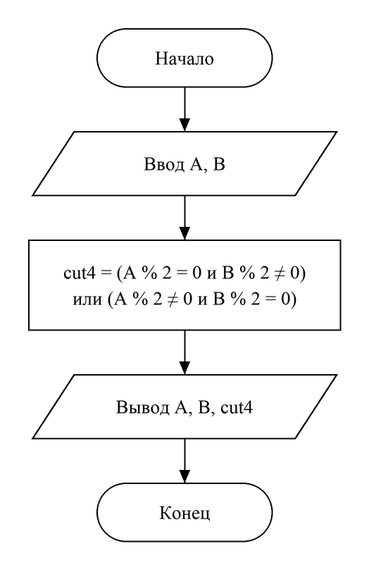

# Домашнее задание к работе №4
Вариант 3

## Условие задачи
**Дележка пиццы.** Друзья заказали пиццу. Они решат, резать ее на 4 или 6 кусков, по простому правилу: если ровно один из них (Ваня A или Петя B) проголодался (его "уровень голода" - четное число), то резать на 4 части. Запишите условие для нарезки на 4 части.

## 1. Алгоритм и блок-схема
### Алгоритм:
1. Начало.
2. Объявить целые переменные:
- **A** — уровень голода Вани;
- **B** — уровень голода Пети;
- **cut4** — результат проверки (1 — резать на 4 части, 0 — нет).
3. Ввести A и B.
4. Вычислить **cut4 = (A % 2 == 0 && B % 2 != 0) || (A % 2 != 0 && B % 2 == 0)**: проголодался (четное число) только Ваня или только Петя.
5. Вывести A, B и значение cut4.
6. Конец.

### Блок-схема:


## 2. Реализация программы
```c
#define _CRT_SECURE_NO_DEPRECATE
#include <stdio.h>
#include <locale.h>

// Вариант 3. Дележка пиццы
// Пиццу режут на 4 части, если проголодался ровно один из друзей:
// у Вани (A) или у Пети (B) уровень голода - четное число, а у другого - нечетное
int main() {
    setlocale(LC_CTYPE, "RUS");
    int A, B; // уровень голода Вани и Пети
    int cut4; // 1 - резать на 4 части, 0 - нет
    printf("Уровень голода Вани (A): ");
    scanf("%d", &A);
    printf("Уровень голода Пети (B): ");
    scanf("%d", &B);
    cut4 = (A % 2 == 0 && B % 2 != 0) || (A % 2 != 0 && B % 2 == 0);
    printf("Ваня: %d, Петя: %d\n", A, B);
    printf("Резать пиццу на 4 части (1 - да, 0 - нет): %d\n", cut4);
    return 0;
}
```

## 3. Результаты работы программы
Случай 1:
```
Уровень голода Вани (A): 2
Уровень голода Пети (B): 5
Ваня: 2, Петя: 5
Резать пиццу на 4 части (1 - да, 0 - нет): 1
```
Случай 2:
```
Уровень голода Вани (A): 4
Уровень голода Пети (B): 8
Ваня: 4, Петя: 8
Резать пиццу на 4 части (1 - да, 0 - нет): 0
```
Случай 3:
```
Уровень голода Вани (A): 3
Уровень голода Пети (B): 7
Ваня: 3, Петя: 7
Резать пиццу на 4 части (1 - да, 0 - нет): 0
```

## 4. Информация о разработчике
Головкова Милена Евгеньевна, бТИИ-261
